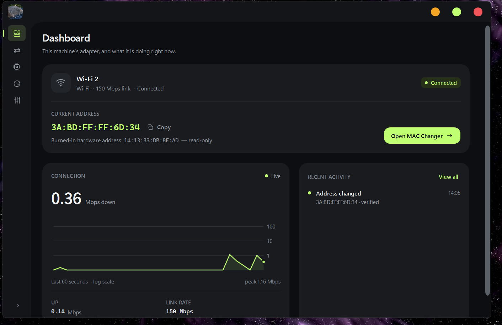

# BigRat MAC Changer v1.1

BigRat MAC Changer is a Windows desktop utility for inspecting network adapters, applying a locally administered MAC address override, and restoring the adapter's original hardware address. It is built with C#, .NET 8, and WPF.

The application performs its work locally. It does not contain telemetry or call an external service. Settings and optional operation history are stored under `%APPDATA%\BigRat`.

## Features

- Discover supported Windows network adapters and display connection, IP, gateway, DNS, link-speed, current-MAC, and hardware-MAC information.
- Generate cryptographically secure, locally administered unicast MAC addresses or validate a manually entered address.
- Apply a MAC override through the adapter's Windows registry entry and optionally restart the adapter so the change can take effect immediately.
- Remove the override to restore the hardware address, including when a driver does not report that address in advance.
- Verify the address reported by Windows after an apply or restore operation.
- Show live download/upload throughput and a rolling 60-second chart for the selected adapter.
- Display read-only system, processor, motherboard, BIOS, memory, storage, graphics, and operating-system information reported by WMI.
- Keep an optional local history of up to 100 MAC operations, including failures and verification status.
- Save local preferences such as accent colour, confirmation behavior, restart behavior, history recording, sidebar state, and the last selected adapter.

## Screenshots



## Requirements

- Windows 10 or Windows 11.
- [.NET 8 SDK](https://dotnet.microsoft.com/download/dotnet/8.0) to build from source.
- .NET 8 Desktop Runtime to run a framework-dependent build.
- PowerShell and standard Windows networking/WMI components.
- Internet access during package restore unless the required NuGet packages are already cached.

The application depends on `System.Management` 8.0.0. The test project additionally uses xUnit, Microsoft.NET.Test.Sdk, and coverlet.collector; their exact versions are declared in `MacChanger.Tests/MacChanger.Tests.csproj`.

## Build from source

Run these commands from the repository root on Windows:

```powershell
dotnet restore .\MacChanger.App\MacChanger.App.csproj
dotnet build .\MacChanger.App\MacChanger.App.csproj --configuration Release
```

The framework-dependent output is created under `MacChanger.App\bin\Release\net8.0-windows\`.

`MacChanger.slnx` contains the application, core library, and test project. It can also be opened with a recent Visual Studio 2022 version that supports the XML solution format. The application project can be built directly as shown above if the installed tooling does not recognize `.slnx`.

To run the included unit tests separately:

```powershell
dotnet test .\MacChanger.Tests\MacChanger.Tests.csproj --configuration Release
```

## Installation

No installer project is included. After building, keep the files from the application output directory together and run `MacChanger.App.exe`. Install the .NET 8 Desktop Runtime first if the target machine does not already have it.

## Basic usage

1. Open BigRat and select a supported adapter.
2. Enter a valid unicast MAC address or use the random-address button.
3. Review the confirmation and approve the Windows elevation prompt to apply the change.
4. Allow the adapter restart if enabled; network connectivity can drop briefly.
5. Use **Restore original** to remove the override and return to the hardware address.
6. Review operation results on the Dashboard or History page.

## Administrator permissions

Adapter discovery, throughput monitoring, settings, and most read-only views do not intentionally request elevation. Applying or removing a MAC override starts PowerShell with the `runas` verb, so Windows displays a UAC prompt. The operation cannot succeed if elevation is denied or unavailable. Some WMI values may also be unavailable without sufficient permission.

## Local data

BigRat creates these files at runtime when needed:

- `%APPDATA%\BigRat\settings.json` — preferences and remembered adapter hardware addresses.
- `%APPDATA%\BigRat\history.json` — optional operation history containing timestamps, adapter names, MAC addresses, results, and verification status.

No configuration file is required in the source tree. History recording can be disabled, and existing history can be cleared from the application.

## Known limitations

- The application is Windows-only because it uses WPF, the Windows registry, WMI, PowerShell, and Windows network-adapter commands.
- MAC overriding is driver-dependent. Some physical, virtual, VPN, or managed adapters may not expose a usable registry entry, may reject an address, or may continue reporting the previous address.
- Most drivers require an adapter restart before an override becomes active, temporarily interrupting connectivity.
- Some drivers do not report their permanent address while an override is active. BigRat remembers a hardware address previously observed without an override, but cannot invent one it has never seen.
- Hardware and network values are limited to what Windows and the installed drivers report.
- No installer, code-signing configuration, or packaged binary release is included in this source repository.

## License

No `LICENSE` file or other licensing terms are present in this repository. No license is granted by this source tree as currently prepared. Add the intended license before publishing if others should be permitted to use, modify, or redistribute the project.
